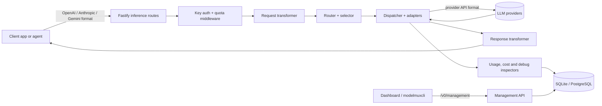

# ModelMux

ModelMux is a self-hosted LLM gateway that gives your clients one consistent API while it translates, routes, meters and observes requests across many model providers.

## What This Project Does

Teams that use several LLM providers end up with client code tied to one vendor's API format, keys scattered across tools, and no single place to see cost, latency or failures. ModelMux sits between your applications and the providers: clients talk to ModelMux using the API format they already know, and ModelMux decides which upstream model serves each request.

It is aimed at developers and small teams who run their own AI tooling (coding agents, chat front-ends, internal services) and want control over routing, spending and reliability.

Main features:

- **Multi-format inference API** – accepts OpenAI Chat Completions, Completions and Responses, Anthropic Messages, Gemini `generateContent`, embeddings, image generation/editing, speech and transcription requests, and translates them to whatever API the chosen provider speaks.
- **Model aliases and routing** – map an alias to one or more provider targets and pick between them with `random`, `in_order`, `cost`, `performance`, `latency`, `usage`, `quota` or `e2e_performance` selectors, with target groups, sticky sessions and alias-to-alias fallback.
- **Resilience** – automatic failover, exponential provider cooldowns, configurable timeouts, stalled-stream detection, per-provider concurrency limits and vision fallthrough for text-only models.
- **API keys and quotas** – issue client keys with allowed/excluded models and providers, IP allow-lists, expiry, and token/request/cost quotas per time window.
- **Provider quota checkers** – built-in checkers for many provider plans (OpenRouter, Copilot, Codex, Claude Code, Z.AI, MiniMax, Kimi, Ollama and more) plus user-written JavaScript checkers that run in a sandboxed worker.
- **OAuth-backed providers** – log in once with an OAuth subscription account and use it as a routing target.
- **MCP proxy** – expose remote (streamable HTTP) or locally launched MCP servers behind ModelMux keys, with usage logs and an OAuth authorization server for MCP clients.
- **Observability** – request logs, token and cost accounting, latency and throughput metrics, provider health, error logs, debug traces and a live system-log stream.
- **Admin dashboard and management API** – a React dashboard at `/ui/` and a documented REST API under `/v0/management/*`, plus the `modelmuxcli` command-line client.
- **SQLite or PostgreSQL** – all configuration lives in the database; migrations run automatically at startup, and sensitive values can be encrypted at rest.

## How It Works

A client sends a request in its own API format to a ModelMux endpoint (for example `POST /v1/chat/completions` or `POST /v1/messages`). The request flows through these pieces:

1. **Fastify server** (`packages/backend/src/index.ts`) registers the inference, management, MCP and OpenAPI routes and serves the built dashboard.
2. **Authentication and quotas** – the client key is checked (`utils/auth.ts`, `routing/key-access-policy.ts`) and quota middleware (`services/quota/`) rejects requests that are over their limits.
3. **Transformers** (`src/transformers/`) parse the incoming format into a unified internal request.
4. **Router** (`services/routing/`) resolves the requested alias to candidate targets, skips providers in cooldown or over capacity, and lets the configured selector pick one.
5. **Dispatcher** (`services/dispatch/`) builds the upstream request in the provider's API format, applies model adapters, sends it, and on failure records a cooldown and fails over to the next candidate.
6. **Response handling** – the upstream response (streamed or not) is transformed back into the client's original format; inspectors record usage, cost, timing and optional debug traces.
7. **Storage** – Drizzle ORM persists configuration, usage, quotas and logs in SQLite or PostgreSQL; the dashboard and CLI read them back through the management API.



## Project Structure

```text
modelmux/
├── package.json                 # Bun workspace root and all project scripts
├── bunfig.toml                  # Test preload and `bun fmt` settings
├── mise.toml                    # Pinned tool versions (Bun, lefthook, frpc)
├── lefthook.yml                 # Git hooks: format, typecheck, tests
├── redocly.yaml                 # OpenAPI lint rules
├── assets/readme/               # Diagrams used in the documentation
├── docs/
│   ├── INSTALLATION.md          # Binary and from-source installation
│   ├── CONFIGURATION.md         # Providers, aliases, keys, quotas, settings
│   ├── CUSTOM_QUOTA_CHECKERS.md # Writing JavaScript quota checkers
│   ├── MCP.md                   # MCP proxy and OAuth for MCP clients
│   ├── TESTING.md               # Test runner and isolation rules
│   └── openapi/                 # Source OpenAPI spec (paths, schemas, responses)
├── packages/
│   ├── backend/
│   │   ├── src/
│   │   │   ├── index.ts         # Server bootstrap: migrations, services, routes
│   │   │   ├── config.ts        # Configuration schemas and loaders
│   │   │   ├── routes/          # Inference, management, MCP and OpenAPI routes
│   │   │   ├── transformers/    # API format translators (OpenAI, Anthropic, Gemini, Responses, …)
│   │   │   ├── services/        # Routing, dispatch, quota, OAuth, MCP, observability
│   │   │   ├── db/              # Database client, migrations runner, repositories
│   │   │   ├── utils/           # Auth, costs, token estimation, logging helpers
│   │   │   ├── types/           # Shared backend types (unified request/response, usage)
│   │   │   └── cli/             # `backup` and `rekey` maintenance commands
│   │   ├── drizzle/
│   │   │   ├── schema/          # Table definitions for SQLite and PostgreSQL
│   │   │   ├── migrations/      # Generated SQLite migrations
│   │   │   └── migrations_pg/   # Generated PostgreSQL migrations
│   │   ├── data/                # Built-in provider presets and their JSON schema
│   │   └── test/                # Test setup, mocks and integration tests
│   ├── frontend/
│   │   ├── build.ts             # Bun + Tailwind build of the dashboard
│   │   └── src/
│   │       ├── pages/           # Dashboard, Providers, Models, Keys, Quotas, Logs, MCP, …
│   │       ├── components/      # UI kit, layout, and feature components
│   │       ├── lib/             # API client, formatting and helper modules
│   │       └── hooks/, contexts/, types/
│   ├── cli/                     # `modelmuxcli` management CLI
│   └── shared/                  # Types and helpers shared by backend and frontend
└── scripts/                     # Dev server, migrations, OpenAPI sync, builds, seeding
```

## Tech Stack

| Layer | Technology | Purpose |
|---|---|---|
| Runtime | Bun 1.4.4 | Runs the server, builds the frontend, compiles binaries and runs tests |
| Language | TypeScript | All packages |
| Backend | Fastify ^5.4.0 | HTTP server for inference, management and MCP routes |
| Validation | Zod ^4.0.14, TypeBox ^0.34.38 | Request and configuration schemas |
| Database ORM | Drizzle ORM ^0.44.4, drizzle-kit ^0.31.4 | Schema, queries and generated migrations |
| Database | SQLite (`bun:sqlite`), PostgreSQL via postgres ^3.4.7 | Configuration, usage and log storage |
| Dev database | PGlite ^0.3.7 | In-process PostgreSQL for local development |
| Model catalog | @earendil-works/pi-ai 1.4.0 | Provider and model metadata, generation helpers |
| Provider SDKs | @google/genai ^1.12.0 | Gemini-specific requests |
| MCP | @modelcontextprotocol/sdk ^1.17.1 | MCP proxy and local MCP servers |
| Logging | winston ^3.17.0 | Structured server logs and log streaming |
| Frontend | React ^19.1.1, React Router ^7.7.1 | Admin dashboard |
| Styling | Tailwind CSS ^4.1.11 | Dashboard styling |
| Charts & UI | Recharts ^3.1.0, lucide-react ^0.536.0, @assistant-ui/react 0.10.35, Monaco editor 4.7.0 | Metrics charts, icons, playground chat, code editors |
| API docs | OpenAPI 3 + Redocly CLI ^2.0.2 | Spec linting, bundling and preview |
| Testing | `bun test`, happy-dom 18.0.1 | Unit and integration tests, DOM tests |
| Git hooks | lefthook ^1.12.2 | Pre-commit formatting, typecheck and tests |

## How to Run This Project

1. **Prerequisites**
   - [Bun](https://bun.sh/) 1.4.4 or newer (`mise install` installs the pinned version from `mise.toml`).
   - Git.
   - Optional: PostgreSQL if you do not want to use the default SQLite database.

2. **Clone**

   ```bash
   git clone https://github.com/jawaddev921-afk/modelmux.git
   cd modelmux
   ```

3. **Install dependencies**

   ```bash
   bun install
   ```

   No lock file is committed, so Bun resolves versions from the `package.json` files. The `postinstall` step prepares `drizzle-kit`, and `prepare` installs the lefthook Git hooks.

4. **Environment variables**

   The server reads its settings from the environment. See `packages/backend/.env.example` and [docs/CONFIGURATION.md](docs/CONFIGURATION.md) for the full list.

   | Variable | Description | Example |
   |---|---|---|
   | `ADMIN_KEY` | Required. Password for the dashboard and the management API | `change-me` |
   | `DATABASE_URL` | Database connection string (`sqlite://…` or `postgres://…`) | `sqlite://./data/modelmux.db` |
   | `DATA_DIR` | Directory for the SQLite file when `DATABASE_URL` is not set | `./data` |
   | `ENCRYPTION_KEY` | Optional key for encrypting secrets at rest (`openssl rand -hex 32`) | `<64-hex-characters>` |
   | `PORT` / `HOST` | Listen port and address (defaults `4000` / `0.0.0.0`) | `4000` |
   | `LOG_LEVEL` | `error`, `warn`, `info`, `debug` or `silly` | `info` |
   | `MODELMUX_USAGE_RETENTION_DAYS` | Days to keep usage and log rows (default 365) | `90` |

5. **Database setup**

   No manual step is needed. On startup the backend runs the bundled Drizzle migrations for the database in `DATABASE_URL` (SQLite migrations in `packages/backend/drizzle/migrations`, PostgreSQL migrations in `packages/backend/drizzle/migrations_pg`). For PostgreSQL, create an empty database first and point `DATABASE_URL` at it. All providers, aliases, keys and quotas are then created through the dashboard or the management API.

6. **Run**

   Development stack (backend with watch mode plus a frontend rebuild watcher):

   ```bash
   ADMIN_KEY="change-me" bun run dev
   ```

   The dev script prints the port, database path and admin key it uses; open `http://localhost:<PORT>/ui/` and sign in with the admin key. Use `bun run dev:pglite` for an in-process PostgreSQL database instead of SQLite.

   Run without the dev tooling:

   ```bash
   bun run build:frontend
   cd packages/backend
   ADMIN_KEY="change-me" DATABASE_URL="sqlite://./data/modelmux.db" bun run start
   ```

   The API is then available at `http://localhost:4000/v1/...` and the dashboard at `http://localhost:4000/ui/`. To build a single self-contained binary instead, see [docs/INSTALLATION.md](docs/INSTALLATION.md) (`bun run build:bin` or the `compile:*` scripts).

   The management CLI talks to a running server:

   ```bash
   MODELMUX_URL="http://localhost:4000" MODELMUX_ADMIN_KEY="change-me" bun run modelmuxcli api list
   ```

7. **Run tests**

   ```bash
   bun test
   ```

   Type-check every workspace with `bun run typecheck`. See [docs/TESTING.md](docs/TESTING.md) for the test isolation rules.
